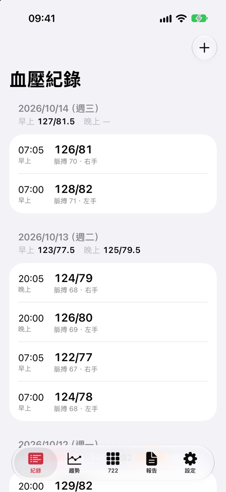
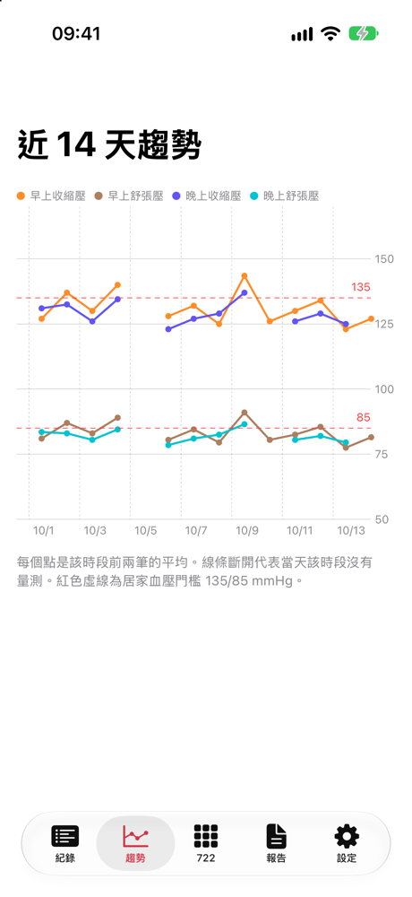
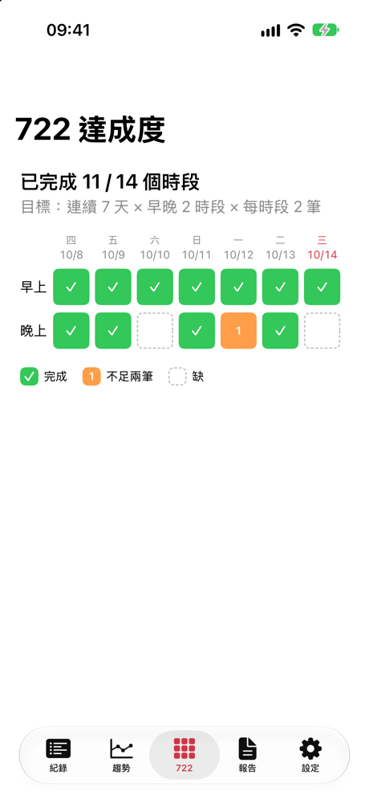
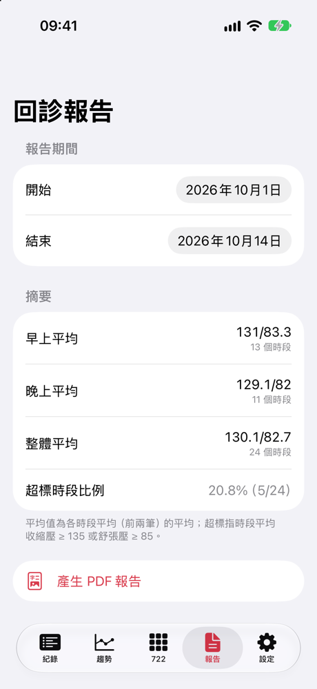
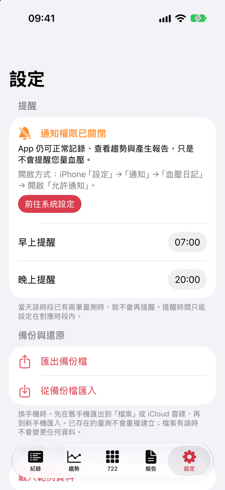
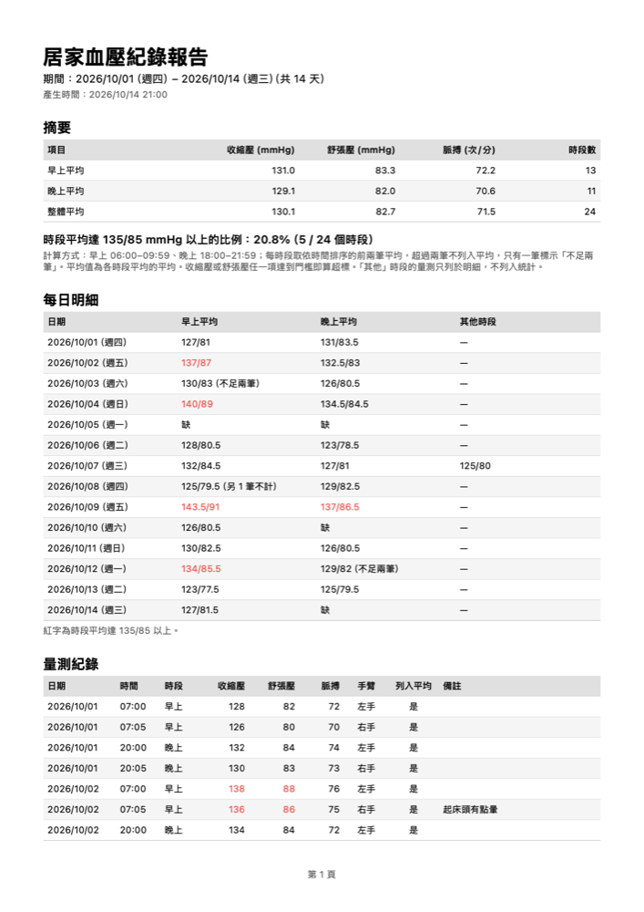

# 血壓日記（BP Diary）

協助高血壓病人依 **722 原則**（連續 7 天、早晚 2 個時段、每時段量 2 次）在家量血壓，並在回診前產生給醫師看的 PDF 報告。出國探親時也能照常記錄，量測時段以**量測當地時間**判斷。

- iOS 17 以上、iPhone 直向
- SwiftUI、SwiftData、Swift Charts；PDF 使用 `UIGraphicsPDFRenderer`
- 無第三方套件、不串 HealthKit、不需後端，資料只存在本機

## 執行方式

1. 使用 **Xcode 16 以上**開啟 `BPDiary.xcodeproj`（專案檔使用 Xcode 16 的資料夾同步格式）。
2. Scheme 選 `BPDiary`，目的地選任一 **iOS 17 以上的 iPhone 模擬器**，按 Run。
3. 在實機執行時，只需在 Signing & Capabilities 選擇自己的 Team。

**載入範例資料**（僅 Debug 建置）：`設定` →「開發者工具」→「載入範例資料」。會以今天為基準產生 14 天資料，內容包含整天缺漏、單筆時段、三筆時段、超標值與「其他」時段。**載入前會清除現有資料。**

啟動參數（供截圖與自動化測試使用；只有 `-loadSampleData` 限 Debug 建置）：

| 參數 | 作用 |
|---|---|
| `-loadSampleData` | 啟動時清除資料並載入範例資料 |
| `-initialTab list\|trend\|adherence\|report\|settings` | 指定啟動時的分頁 |
| `-inMemoryStore` | 使用記憶體資料庫（UI 測試用） |
| `-postDayChangeAfter <秒>` | 啟動後指定秒數發出換日事件，模擬 App 開著跨過午夜（限 Debug，UI 測試用） |

## 測試

```sh
xcodebuild test -project BPDiary.xcodeproj -scheme BPDiary \
  -destination 'platform=iOS Simulator,name=iPhone 17'
```

- **單元測試**（Swift Testing）：64 個，位於 `BPDiaryTests/`。其中 `SampleReportExportTests` 平時會略過，只在產生範例 PDF 時執行。
- **UI 測試**（XCTest）：6 個，位於 `BPDiaryUITests/`。涵蓋：拒絕通知權限後仍可使用、不合理數值無法儲存、刪除前需確認、把時間從早上改到晚上後各畫面更新、PDF 經分享選單存到「檔案」、跨過午夜時正在填的表單不會被關閉。
  執行前請先移除模擬器上的 App，讓系統重新詢問通知權限：`xcrun simctl uninstall booted com.example.bpdiary`。
- 完整測試結果見 [`docs/TEST_REPORT.md`](docs/TEST_REPORT.md)。

重新產生範例 PDF：

```sh
TEST_RUNNER_SAMPLE_PDF_PATH=$PWD/docs/sample-report.pdf xcodebuild test \
  -project BPDiary.xcodeproj -scheme BPDiary \
  -destination 'platform=iOS Simulator,name=iPhone 17' \
  -only-testing:BPDiaryTests/SampleReportExportTests
```

## 畫面截圖

| 列表 | 趨勢圖 | 722 達成度 |
|---|---|---|
|  |  |  |

| 回診報告 | 設定（已拒絕通知權限） | PDF 第 1 頁 |
|---|---|---|
|  |  |  |

範例 PDF：[`docs/sample-report.pdf`](docs/sample-report.pdf)，由範例資料產生，期間為 2026/10/01–2026/10/14，共 3 頁。

## 規則說明

### 輸入驗證

- 收縮壓 60–260、舒張壓 30–160、脈搏 30–220 mmHg／次/分，皆須為整數，且收縮壓必須大於舒張壓。
- 量測時間不能晚於現在：日期選擇器只能選到現在，驗證時容許比現在晚 5 分鐘以內，以吸收裝置時鐘誤差。這避免轉錯日期滾輪時，未來的量測抑制提醒、讓 722 格子預先變成完成，或出現在報告中。
- 備註最多 200 字。
- 匯入備份時套用同樣的規則，任何一筆不符就整份拒絕。

### 時段歸類

| 時段 | 範圍（含起點、不含終點） |
|---|---|
| 早上 | 06:00:00 ≤ t < 10:00:00 |
| 晚上 | 18:00:00 ≤ t < 22:00:00 |
| 其他 | 其餘時間 |

- 例如 07:30 是早上、19:59 是晚上、10:00:00 和 10:00:01 都是其他。
- **以量測當地的時區判斷**：每筆量測都會記下當時的時區。在溫哥華早上 07:30 量的資料，回台灣後仍然是「溫哥華那天的早上」，不會因為換算成台灣時間（22:30）而被歸到「其他」。
- 時段與統計一律即時計算、不存入資料庫，所以修改量測時間後，列表、達成度、趨勢圖、報告都會自動更新。

### 時段平均與 722 達成度

- 同一天、同一時段的量測視為一個時段，依**量測時間**排序後取**前兩筆**平均。量測時間相同時，再依建立時間、id 排序，確保結果固定。
- 只有一筆時照樣計算，但標示「不足兩筆」。第三筆以後保留在紀錄中，列表會標示「未列入平均」；「其他」時段的量測在列表中一律標示「未列入平均」。
- 722 達成度方格是**最近 7 天（含今天）× 早晚**，每格狀態為：完成（≥ 2 筆）、不足兩筆（1 筆）、缺（0 筆）。
- 「其他」時段的量測不列入時段平均、達成度、趨勢圖與報告統計，只出現在列表和報告的明細中。

### 回診報告

- **早上 / 晚上平均**：區間內各時段平均的平均，每個時段權重相同。
- **整體平均**：早上和晚上所有時段一起平均。
- **超標比例**：時段平均的收縮壓 ≥ 135 **或** 舒張壓 ≥ 85 的時段數 ÷ 早晚時段總數。
- 報告區間以量測當地的日期篩選。
- PDF 為 A4 直向，內容依序為摘要、超標比例、每日明細（含缺漏的日子）、量測原始紀錄。表格會逐列計算高度，放不下就換頁並重畫表頭，所以不會被截斷。

### 提醒通知

- 預設早上 07:00、晚上 20:00，可在設定頁調整。可選的時間限制在對應時段內（早上 06:00–09:59、晚上 18:00–21:59），避免提醒後量到的資料不屬於該時段。
- 系統的重複通知無法「只跳過某一天」，所以 App 會排定**未來 30 天的單次通知**（30 天 × 2 時段 = 60 則，在 iOS 每個 App 64 則的上限內，並涵蓋回診前兩週的量測期）。每次新增、編輯、刪除量測、修改提醒時間、取得通知權限、跨過午夜，或 App 回到前景時，都會整批重排；**當天該時段已有兩筆量測就不排**。
- 重排會依序執行：前一次還沒完成時，新的重排會等它結束才開始。這樣可以避免兩次重排交錯，讓已有兩筆的時段又被加回提醒。
- 通知以裝置當地時間觸發，出國時也會在當地的早上和晚上提醒。
- 拒絕通知權限時，其他功能照常運作，設定頁會顯示開啟方式和「前往系統設定」按鈕。

**驗證「已有兩筆就不提醒」**：自動化測試在 `NotificationPlannerTests` 和 `ReminderSchedulerTests`。手動驗證步驟（需在早上時段 06:00–09:59 內進行）：

1. 允許通知後，在設定頁把「早上提醒」設為 2 分鐘後。
2. 新增 2 筆量測時間在今天早上的資料，然後回到主畫面等待。到了提醒時間**不會**收到通知。
3. 刪除其中 1 筆，再把提醒設為 2 分鐘後，回到主畫面等待。這次**會**收到通知。

### 備份與還原（匯入去重規則）

設定頁的「匯出備份檔」會產生 JSON，可以存到「檔案」或 iCloud 雲碟；換手機後用「從備份檔匯入」還原。

```json
{
  "schemaVersion": 1,
  "exportedAt": "2026-10-14T13:00:00.000Z",
  "measurements": [
    {
      "id": "7F1C…",
      "systolic": 128, "diastolic": 82, "pulse": 70,
      "measuredAt": "2026-10-13T23:00:00.000Z",
      "timeZone": "Asia/Taipei",
      "arm": "left", "note": "", "createdAt": "2026-10-13T23:00:05.123Z"
    }
  ]
}
```

**去重規則**：符合下列任一條件，就視為「同一筆量測」並略過。既有資料不會被覆寫。

1. `id` 相同。
2. `id` 不同，但**量測時間（精確到秒）+ 收縮壓 + 舒張壓 + 脈搏 + 手臂**完全相同。例如同一筆資料在兩支手機上各輸入過一次。

同一份檔案裡重複的資料也只會建立一次。所以匯出後再匯入同一份檔案，筆數不會改變。

**格式錯誤的處理**：匯入時會先完整解析整份檔案，並逐筆驗證數值範圍、收縮壓 > 舒張壓、時區是否有效。**任何一筆有誤就整份拒絕**，並顯示錯誤訊息。如果寫入時發生錯誤，會回復到匯入前的狀態，既有資料不會有任何變更。

## 驗收項目對照

| 驗收項目 | 對應的測試或驗證方式 |
|---|---|
| 120/130 無法儲存並在欄位顯示錯誤；超出範圍無法儲存 | `MeasurementValidatorTests`、`MeasurementDraftTests`、UI 測試 `testInvalidValuesCannotBeSaved` |
| 07:30 早上、19:59 晚上、10:00:01 其他 | `SlotClassifierTests.classifiesByLocalTime` |
| 3 筆只取前兩筆；1 筆標示不足兩筆 | `SessionAggregatorTests` |
| 早上已有兩筆後不再提醒 | `NotificationPlannerTests`、`ReminderSchedulerTests`、上方的手動步驟 |
| 拒絕通知權限後功能正常、設定頁有提示 | UI 測試 `testAppKeepsWorkingAfterDenyingNotifications` |
| 刪除前需確認 | UI 測試 `testDeleteRequiresConfirmation` |
| 趨勢圖缺資料不畫成 0，並有 135/85 參考線 | `TrendBuilderTests`（缺資料的日子沒有點，線條在缺口斷開） |
| 722 方格三種狀態 | `AdherenceCalculatorTests` |
| 報告平均與超標比例和手算一致 | `ReportCalculatorTests`（手算過程寫在檔案註解中） |
| PDF 中文正常、表格不截斷 | `PDFReportRendererTests`（擷取中文文字、30 天資料跨頁後最後一列仍存在、最長備註完整呈現）；UI 測試 `testReportPDFCanBeSavedToFiles` |
| 匯出再匯入筆數不變；格式錯誤時資料不變 | `BackupServiceTests`、`BackupDeduplicationTests` |
| 時間從早上改到晚上，各功能都跟著更新 | `EditPropagationTests`、`DailyGroupingTests`；UI 測試 `testEditingTimeFromMorningToEveningUpdatesEveryScreen` |
| 範例資料（14 天、含缺漏與超標） | `SampleDataFactoryTests` |

## 專案結構

```
BPDiary/
├─ App/         進入點、分頁、啟動參數、通知前景顯示
├─ Models/      BPMeasurement（SwiftData）
├─ Domain/      純邏輯：驗證、時段歸類、時段平均、達成度、趨勢、報告、提醒規劃、備份格式與去重
├─ Services/    通知排程、備份存取、PDF 產生、範例資料
├─ Features/    各畫面（Entry、List、Trend、Adherence、Report、Settings）
└─ Support/     台灣日期與數值格式
BPDiaryTests/   單元測試（Swift Testing）
BPDiaryUITests/ UI 測試（XCTest）
```

計算邏輯都放在 `Domain/`，不依賴 SwiftUI 或 SwiftData，處理的是值型別 `Reading`，所以測試不需要建立資料庫。

## 已知限制

- 連續超過 30 天沒開 App，之後就不會再提醒，因為排好的單次通知用完了。只要開一次 App，就會重新排定未來 30 天。30 天已是 iOS 待發通知上限（64 則）內能排的最長天數。
- 提醒是否發出，是依「排程當下」的資料決定。這不影響正常使用，因為量測都在 App 內新增，新增後會立即重排。
- 趨勢圖和達成度的「今天」以裝置目前時區為準。在出國當天，量測地日期和裝置日期可能差一天。
- 報告的日期區間以量測當地日期篩選；PDF 中如果某筆量測的時區和產生報告時不同，會在備註標示量測地時區。
- 匯入只會新增，不會更新已存在的量測；兩邊同 id 但內容不同時，以手機上既有的資料為準。
- 刪除量測無法復原，也沒有垃圾桶。
- 備註上限 200 字。這是為了確保 PDF 中單一列不會高過一頁而被截斷；超過上限的備份檔會被整份拒絕。
- 資料只存在本機，刪除 App 會遺失資料，請定期匯出備份。
- 未提供 App 圖示、iPad 版面與橫向畫面。
- UI 測試需要在「尚未詢問過通知權限」的模擬器上執行。
